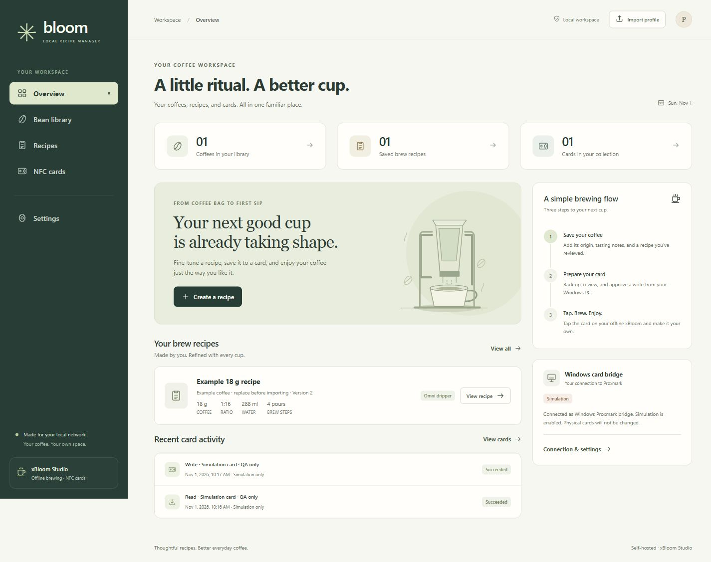

# xBloom Local

A local recipe library for xBloom Studio, with a responsive dashboard, a FastAPI/SQLite backend, and a separate Windows Proxmark bridge. The normal brewing workflow uses custom NFC cards; it does not connect to the xBloom machine over Bluetooth or the internet.

The dashboard separates **Overview**, **Beans**, **Recipes**, **Cards**, and **Settings**. Bean facts and their sources are kept apart from proposed brewing recommendations. Recipes default to 18 g, retain version history, and show changes required by NFC encoding.



The screenshot uses a disposable test library. Your first launch starts with an empty library and asks you to create your local account.

## Start on Windows

Double-click **Start xBloom.cmd**. It starts the app and opens your browser once the server is ready. Keep its window open while using the app; press Ctrl+C in that window to stop it. The launcher changes PowerShell execution policy only for that process, not your machine's policy.

Or start it from PowerShell in this checkout:

```powershell
.\scripts\start-local.ps1 -OpenBrowser
```

The script creates a local virtual environment and installs dependencies on first launch. It uses Python 3.11 or newer; use `-PythonPath 'C:\path\to\python.exe'` if autodetection cannot find it. After dependency changes, run with `-Install`.

Open **http://127.0.0.1:8000** and complete the initial account setup. The preview binds to loopback, so it is only accessible on this computer. No default password is supplied. The app reads process environment variables; copying `.env.example` to `.env` alone does not load it.

You can also initialize the account interactively:

```powershell
.\.venv\Scripts\python.exe -m app.manage setup
```

## Your workflow

1. Give Codex a coffee product URL and ask for a profile using [the import schema](docs/import-schema.md). Missing product facts must remain unknown.
2. Review the generated bean facts and recipe, then import the approved profile.
3. Adjust the recipe after tasting; each saved recipe version remains available.
4. Register each physical card with its own label. Several custom cards may share a UID, so the label matters.
5. Read the physical card through the Windows bridge and save its original contents.
6. Review the encoded recipe and explicitly approve the selected card write.
7. The bridge reads the card back and verifies the written data. Test the verified card on your offline xBloom.

The supplied community dump is reference material, not a backup of every physical card. Original backups and pre-write snapshots are kept per card. No hardware write is authorized merely by starting the app or generating a recipe.

## Deployment and operation

- [Debian LXC, LAN HTTPS, Windows bridge, and recovery](docs/deployment.md)
- [First physical-card acceptance checklist](docs/deployment.md#first-physical-card-acceptance-checklist)
- [Structured profile import](docs/import-schema.md)
- [NFC format, validated capabilities, and limitations](docs/nfc-format.md)

Runtime storage defaults to `./data`; configure `XBLOOM_DATA_DIR` for a persistent directory. Database files, photos, secrets, and card dumps are excluded from source control. Private GitHub hosting is for source and documentation; the application and its data remain on your LAN.

This checkout includes deployment configuration. It does **not** imply a Proxmox container has been created, a server has been deployed, or a physical card has been written.

## Development checks

```powershell
.\.venv\Scripts\python.exe -m pytest -q
```

Tests use synthetic card data and temporary storage. Personal dumps must not be added as test fixtures or committed.

## Technical references

The NFC format implementation is checked against [XBRecipeWriterPlus](https://github.com/CrazyCoder/XBRecipeWriterPlus), with [xbloom-agent](https://github.com/denull0/xbloom-agent) and [xbloom-ble](https://github.com/Janczykkkko/xbloom-ble) as additional technical references. The Bluetooth project is a reference only. Passing software checks is separate from testing a written card on your actual machine.

Pinned references, attribution, and inspected license evidence are recorded in [THIRD_PARTY_NOTICES.md](THIRD_PARTY_NOTICES.md).
